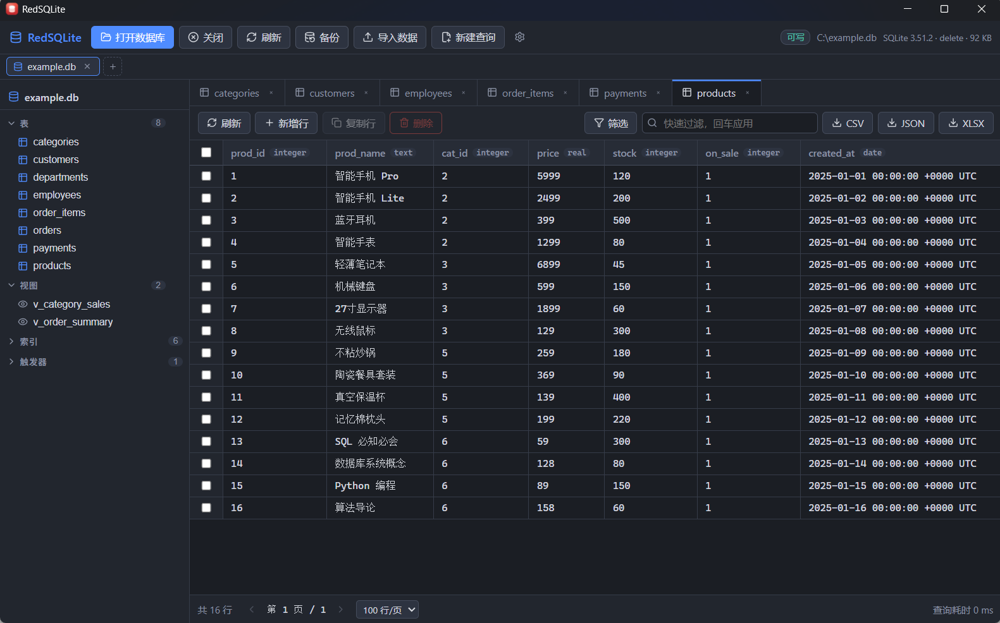

# RedSQLite



精简版 Navicat —— 仅支持 SQLite 的轻量桌面客户端。

基于 **Wails v3 + React 19 + TypeScript + Go**，纯 Go 驱动（无 CGO），优先面向 Windows 11，支持 ARM64 交叉构建。

## 功能特性

### 数据库连接

- 打开本地 `.db` / `.sqlite` / `.sqlite3` 文件，原生文件对话框 + 最近打开列表
- 多数据库并存：顶部数据库 Tab 条切换，同一路径自动复用连接；「+」先弹最近列表优先的子窗口（含只读开关与已打开标记）
- 只读打开：显式勾选，或文件不可写时自动以只读模式打开
- 一键在线备份：`VACUUM INTO` 生成紧凑独立副本（只读连接也可用，目标文件不可覆盖）

### 数据浏览与编辑

- 分页浏览（默认 100 行/页），行数统计异步进行，大表翻页不卡顿；默认顺序与排序浏览均走游标分页，深翻页不减速
- 排序、文本快速过滤、结构化列筛选构建器（= ≠ > ≥ < ≤ / 包含 / 范围 / 为空 / 非空，多条件 AND 组合，与排序叠加）
- 单元格编辑（双击）、新增行、多选删除（事务 + 二次确认）、复制行（单列 INTEGER 主键自动取新自增值）
- NULL / BLOB / 超长文本安全展示；BLOB 查看器支持完整内容在线读取、常见图片格式预览（PNG/JPEG/GIF/BMP/WebP/ICO）、另存为、从文件替换
- 超出 JS 安全整数范围（±2^53-1）的 INTEGER 按字符串精确显示与回传，不丢精度
- 无主键表自动回退 `rowid` 定位；视图与无定位字段对象默认只读

### SQL 工作台

- CodeMirror 编辑器：SQL 高亮、真实表/列名自动补全、随主题切换
- Ctrl+Enter 执行；多语句（分号分隔）在单事务中逐条执行、逐条展示结果，任一失败整体回滚
- 危险语句（DROP / 无 WHERE 的 UPDATE·DELETE / VACUUM 等）逐条列出原因并二次确认
- 查询中止（实时计时反馈）、SQL 格式化、查询历史、结果导出 CSV / JSON / XLSX

### 结构设计

- 左侧结构树：表 / 视图 / 索引 / 触发器分组；表与视图右键菜单
- 新建表设计器：列定义、主键、外键（ON DELETE/UPDATE 动作）、生成列（VIRTUAL/STORED）
- 表结构编辑：改列名、加列、删列、改表名、删表——所有操作先生成 SQL 预览（含阻断原因与影响提示）再执行
- 表重设计（RedesignModal）：改类型 / NOT NULL / 默认值、调列序、换主键、新增列回填、新增外键、表改名；单事务重建（建新表→拷数据→删旧改名→重建索引触发器），提交前全库外键校验，大表按 rowid 分块拷贝并实时回报进度
- 索引可视化创建（自动命名、同列重复警告）；触发器/索引 DDL 查看与删除
- 视图设计器：编辑 SELECT 主体 + SQL 预览确认；编辑为 DROP+CREATE 单事务原子替换；删除前扫描引用给出失效警告

### 导入 / 导出 / 跨库传输

- 导出：CSV（UTF-8 + BOM，Excel 无乱码）、JSON、Excel .xlsx（保留数值/布尔类型，流式写出），整表或查询结果
- 导入向导：CSV（自动识别分隔符与 BOM）与 Excel .xlsx（先选工作表）——选文件 → 预览前 50 行 → 列映射 → 单事务插入，失败整体回滚
- 跨连接传输：在两个已打开的连接之间复制表（仅结构 / 结构+数据，索引触发器默认连带）；预检同名冲突与外键依赖；目标单事务分批写入，进度实时回报

### 安全与设置

- 值全部参数绑定；表名/列名白名单校验；结构编辑 DDL 由后端统一生成（默认值字面量白名单）
- 查询超时与最大返回行数限制；主键 / rowid 列禁止 UI 编辑
- 设置：每页行数、查询超时、最大返回行数、WAL 开关（默认关闭）、界面主题（跟随系统 / 浅色 / 深色）
- 错误日志落盘 `%APPDATA%\RedSQLite\logs\redsqlite.log`（5MB 启动轮转）

## 使用入门

1. **打开数据库**：欢迎页或顶部「+」选择文件（可勾选「以只读方式打开」），最近打开的库在列表最上方
2. **浏览数据**：结构树双击表；用表头排序、工具栏过滤与「筛选」构建器收窄范围；双击单元格编辑，工具栏可增行 / 删行 / 复制行 / 导出
3. **查看与修改结构**：表右键「查看结构」进入结构页；「重设计」打开表重建向导，所有改动先出 SQL 预览确认
4. **执行 SQL**：新建查询 Tab（Ctrl+Enter 执行；多条语句以分号分隔自动走事务；危险语句会先弹确认）
5. **导入导出**：表数据页工具栏导出；「导入」按钮走向导；表右键「传输到其他库…」跨连接复制表
6. **备份**：工具栏「备份」选择保存位置即生成紧凑副本

## 从源码构建

环境要求：

| 组件                                   | 版本                            |
| -------------------------------------- | ------------------------------- |
| Windows                                | 11 amd64（支持 ARM64 交叉构建） |
| Go                                     | 1.25+                           |
| Node.js                                | 22+                             |
| Wails CLI / Go 库 / `@wailsio/runtime` | v3.0.0-beta.12（三处必须一致）  |
| `modernc.org/sqlite`                   | v1.44.3（纯 Go，无 CGO）        |

```bash
# 安装 Wails CLI
go install github.com/wailsapp/wails/v3/cmd/wails3@v3.0.0-beta.12

# 安装依赖并进入开发模式（热重载）
cd frontend && npm install && cd ..
wails3 dev

# 生产构建（产物：bin/redsqlite.exe）
wails3 task build

# Windows ARM64 交叉构建（产物：bin/redsqlite-arm64.exe）
wails3 task build:arm64

# NSIS 安装包（需 makensis 在 PATH；产物：bin/RedSQLite-amd64-installer.exe）
wails3 task package

# 测试
go test ./domain/... ./internal/... ./repository/... ./services/...
cd frontend && npx tsc --noEmit && npm test
```

版本号在 `Taskfile.yml` 的 `APP_VERSION`、`build/windows/info.json`、`build/windows/nsis/project.nsi` 三处同步维护，经 `-ldflags` 注入二进制。

## 项目结构

```text
├── main.go                 Wails 应用入口（窗口 + 服务注册）
├── domain/                 领域模型（数据库/结构/查询/设置/表结构操作）
├── internal/
│   ├── identifier/         标识符校验与安全引用（防注入）
│   ├── sqliteutil/         SQL 规范化、分类、多语句拆分、危险检测
│   ├── schemadsl/          DDL 生成器（ALTER/CREATE TABLE）
│   ├── cell/               单元格值 JSON 编解码（BLOB/截断/大整数标记）
│   ├── exporter/           CSV / JSON / XLSX 流式导出
│   ├── tabular/            CSV/XLSX 共用导入模型与事务引擎
│   ├── csvimport/          CSV 解析（BOM/分隔符识别）
│   ├── xlsximport/         Excel 解析（excelize：工作表/预览/导入）
│   ├── logging/            slog 日志落盘（%APPDATA%\RedSQLite\logs）
│   └── appdata/            设置与最近打开（%APPDATA%\RedSQLite）
├── repository/             SQLite 数据访问（Store 多连接注册表；含跨连接传输引擎）
├── services/               Wails 服务（Database/Schema/Data/Query/Export/Import/File/Recent/Settings/Transfer）
└── frontend/               React + TS（Vite）
    ├── bindings/           wails3 生成的 TS 绑定（勿手改）
    └── src/
        ├── api/            绑定薄封装（组件不直接依赖 bindings）
        ├── stores/         Zustand（连接/标签页/设置/提示）
        ├── components/     DataGrid、结构树、结构操作弹窗、视图设计器、传输/导入向导、BLOB 查看器等
        ├── pages/          欢迎页、表数据、表结构、SQL 查询
        └── styles/         全局样式（深色 + 浅色主题 CSS 变量）
```

数据流：React 组件 → `src/api`（带 connId）→ 生成的 bindings → Go services（connID 首参）→ repository（按连接构造）→ `database/sql` → SQLite。

## 设计要点

- **多连接**：`Store` 连接注册表，每连接独立 `*sql.DB` 且 `SetMaxOpenConns(1)`、独立取消 context；同一路径复用同一连接避免自锁；连接级 PRAGMA（busy_timeout / foreign_keys / 可选 WAL）经 DSN `_pragma` 参数保证生效
- **行定位**：主键 → rowid 回退（结果集注入 `__rowid__` 列）→ 视图/WITHOUT ROWID 只读；主键列与 rowid 禁止 UI 编辑
- **游标分页**：默认顺序按 rowid/单列主键游标翻页；排序浏览按排序列+游标列复合排序用 row-value 比较 `(a, b) > (?, ?)` 定位；排序列含 NULL、视图、复合主键场景回退 LIMIT/OFFSET；行数统计异步获取，翻页不等 `COUNT(*)`
- **多语句执行**：分号拆分（字符串/注释内分号不算）→ 单事务逐条执行 → 任一失败整体回滚；批量内拒绝显式事务控制
- **结构编辑**：DDL 由后端 `schemadsl` 生成，前端只预览确认；表重设计单事务执行，触发器先删后建（规避 RENAME 重解析悬空引用），提交前 `PRAGMA foreign_key_check` 全库校验
- **单元格编码**：BLOB / 超长文本 / 超安全范围大整数经 `internal/cell` 转标记对象传输，前端类型判别一一对应；编辑大整数字符串原样回传由 SQLite 亲和性转换
- **二进制传输**：BLOB 完整内容与文件读写经 Base64 走绑定传输（32MB 上限）；导出文件写原始完整值，与界面展示协议分离
- **跨连接传输**：源/目标各是独立连接、事务各自开，绝无跨库事务；源侧按 rowid 范围分批读，目标单事务预编译插入；同连接传输直接拒绝（会死锁）
- **进度事件**：表重建 / 跨连接传输经 Wails 事件回报进度，前端按连接 ID 过滤防多库串扰
- **大结果保护**：单次查询默认最多 10000 行（可设置），超出标记截断；单元格文本最多展示 1MB

## 已知限制

- 多语句不支持含 `BEGIN...END` 体的 `CREATE TRIGGER`（请单独执行）；`VACUUM` 等事务外语句只能单条执行
- 排序浏览的游标分页在排序列含 NULL、视图、复合主键场景回退 LIMIT/OFFSET
- 表重建不支持含 CHECK / COLLATE 约束、生成列的表（明确阻断而非静默丢失定义）；复合外键涉及删列/改名列时阻断
- 跨连接传输不复制 rowid / 自增计数；不支持覆盖目标同名表
- Excel 导入按原始值处理（日期为 Excel 序列数）；不支持 .xls 旧格式；BLOB 在线查看与文件传输上限 32MB（图片预览超 10MB 只显示信息）
- NSIS 安装包仅 amd64；同一路径以不同模式二次打开时沿用首次打开的模式
